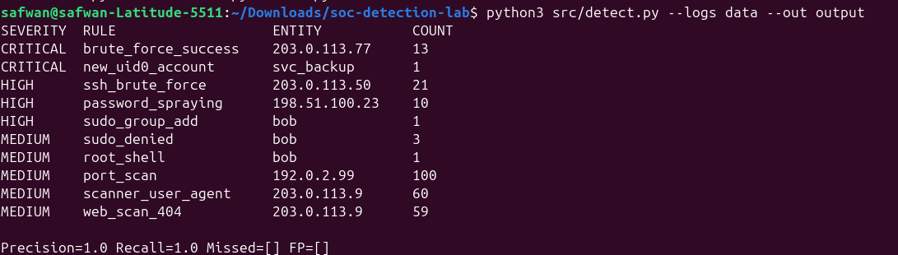

# SOC Detection Lab

[](../../actions)

A small, end-to-end **blue-team lab**: generate realistic attack logs, detect them with
a rule-based engine, map every alert to **MITRE ATT&CK**, and **measure detection quality**
(precision / recall) against a ground-truth file. CI runs the whole pipeline on every push.

> All attacker IPs use RFC 5737 documentation ranges, and all data is synthetic. Nothing here touches a real system.

## Architecture

```
generate_logs.py ──► data/auth.log, access.log, firewall.log + ground_truth.json
                                   │
                                   ▼
                  detect.py (parsers → rules.yaml → alerts)
                                   │
                  ┌────────────────┴───────────────┐
                  ▼                                ▼
           output/alerts.json              output/report.md
                                    (severity, MITRE, response playbook,
                                     precision/recall vs ground truth)
```

## Attack scenarios simulated

| Scenario | Log source | Detection rule | MITRE ATT&CK |
|---|---|---|---|
| SSH brute force | auth.log | `ssh_brute_force` | T1110.001 |
| Password spraying | auth.log | `password_spraying` | T1110.003 |
| Brute force → successful login | auth.log | `brute_force_success` | T1078 |
| Failed privilege escalation | auth.log | `sudo_denied` | T1548.003 |
| Root shell via sudo | auth.log | `root_shell` | T1548.003 |
| User added to sudo group | auth.log | `sudo_group_add` | T1098 |
| Backdoor account with UID 0 | auth.log | `new_uid0_account` | T1136.001 |
| Port scan | firewall.log | `port_scan` | T1046 |
| Directory brute force | access.log | `web_scan_404` | T1595.003 |
| Scanner user-agent (gobuster) | access.log | `scanner_user_agent` | T1595.002 |

## Demo 

See a full example report: [docs/sample_report.md](docs/sample_report.md)

## Quick start



```bash
pip install -r requirements.txt
python src/generate_logs.py --out data      # create synthetic logs
python src/detect.py --logs data --out output
pytest -q                                   # run tests
```

Example output:

```
SEVERITY  RULE                   ENTITY           COUNT
CRITICAL  brute_force_success    203.0.113.77     13
CRITICAL  new_uid0_account       svc_backup       1
HIGH      ssh_brute_force        203.0.113.50     21
...
Precision=1.0 Recall=1.0 Missed=[] FP=[]
```

## How detection works

- **Sliding window** counting: "N events (or N *distinct* values) from one entity within T seconds".
- **Single-event rules** for things that are never normal (UID 0 account creation, sudo group changes).
- **Correlation**: `brute_force_success` links many failures to a later success for the same user + IP.
- All thresholds live in [`config/rules.yaml`](config/rules.yaml) (detection-as-code, so tuning needs no code change).

## Known limitations (honest list)

- Rules are threshold-based; a patient attacker staying under thresholds will evade them.
- Synthetic data is cleaner than production logs, so real-world false-positive rates will be higher.
- No GeoIP / threat-intel enrichment yet; no automatic blocking.

## Roadmap

- [ ] Sigma rule export
- [ ] Kill-chain correlation (recon → brute force → privesc as one incident)
- [ ] IP enrichment (AbuseIPDB / GeoIP)
- [ ] Push alerts into ELK / Splunk dashboards
- [ ] Windows Event Log scenarios (4625, 4672, 4720)

## Analyst notes

*Write your own investigation here: pick one alert, explain how you triaged it,
which logs you pivoted to, what you'd escalate, and how you'd tune the rule to cut false positives.*
